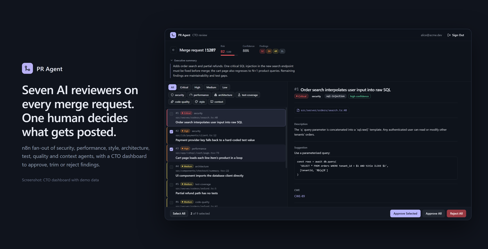
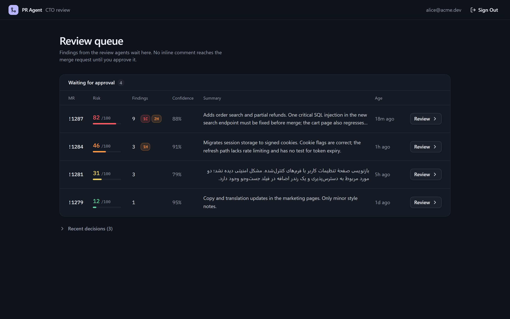
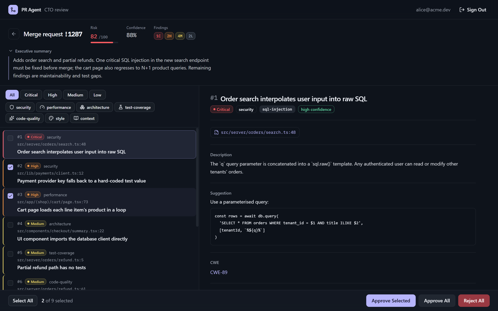
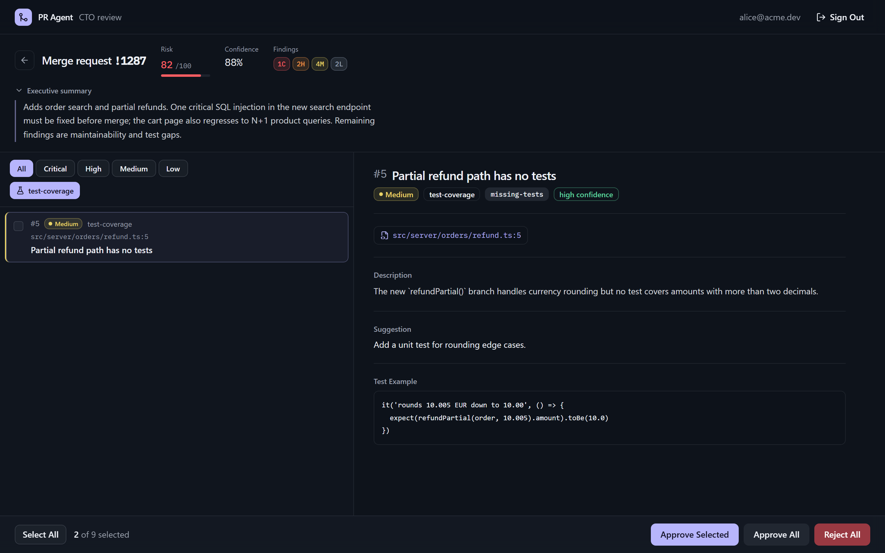
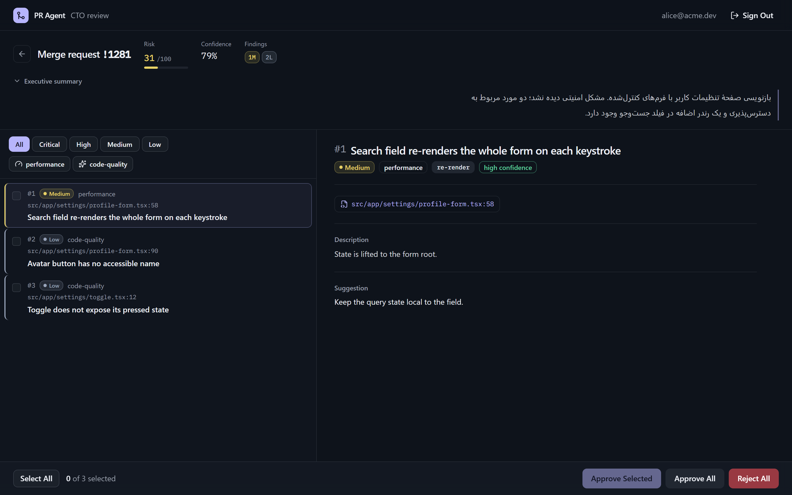
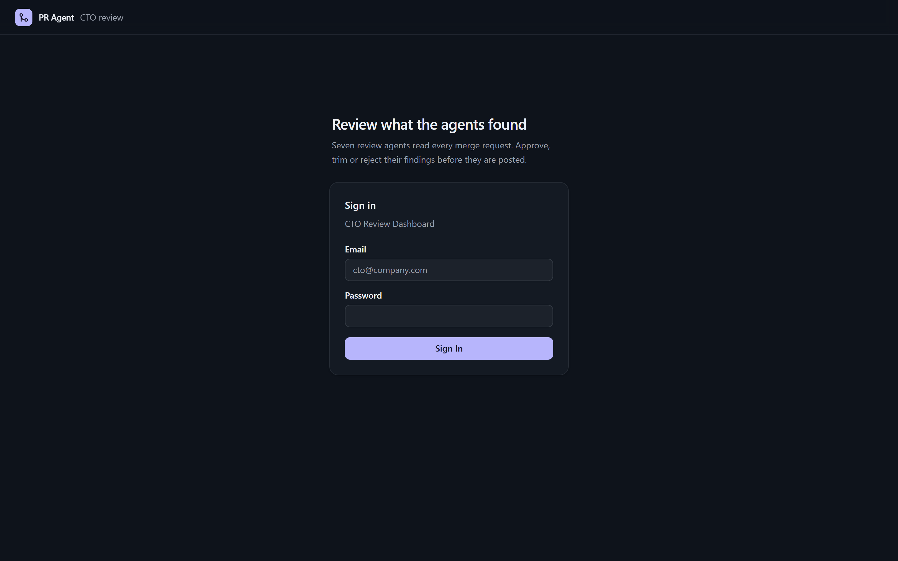
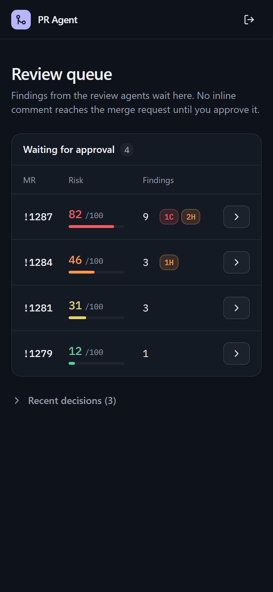
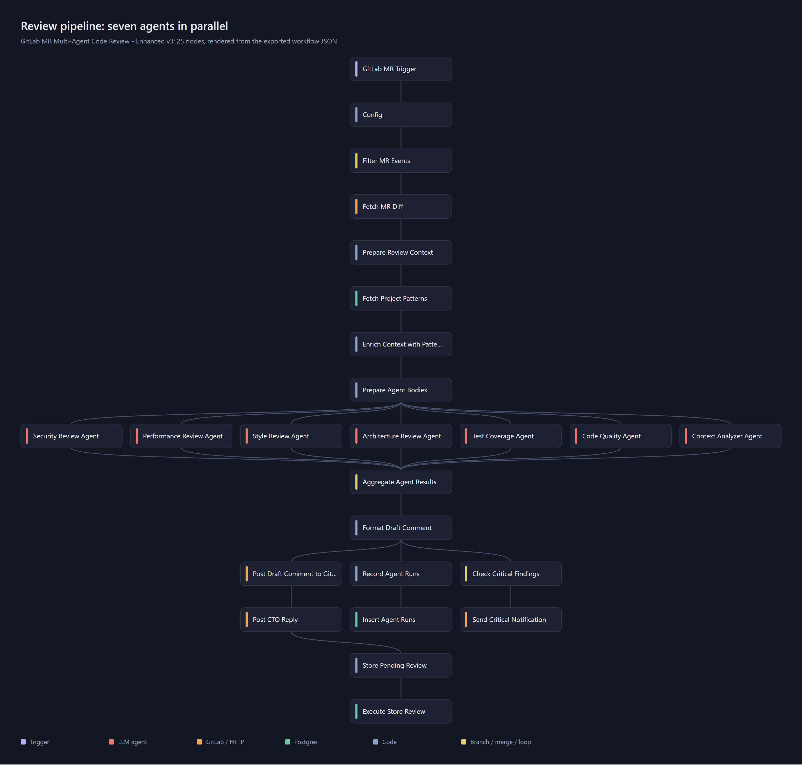
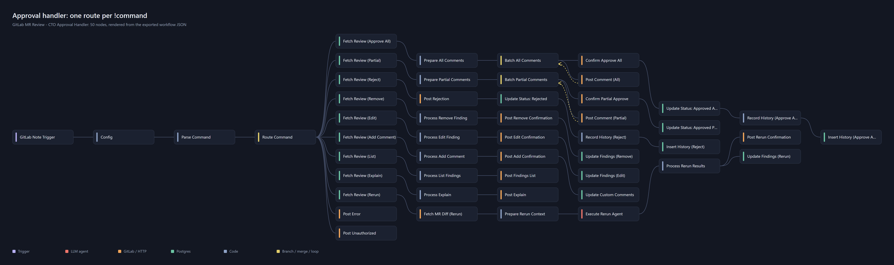
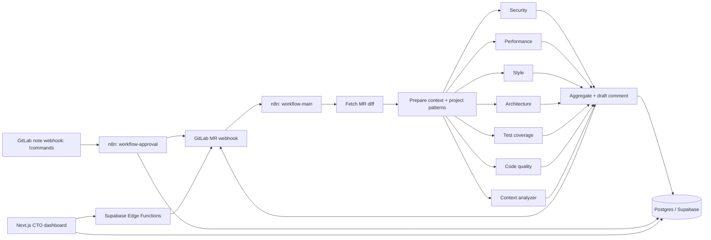

# PR Agent — multi-agent GitLab merge request review in n8n



**Seven AI reviewers on every merge request, and one human who decides what gets posted.**


Seven specialised LLM review agents run in parallel on every merge request. A reviewer approves, edits or explains the findings from GitLab comments or a web dashboard, and approved/rejected findings feed back into later reviews.

## Highlights

- **Parallel fan-out:** 7 agent calls per MR in one n8n workflow (25 nodes), merged into one scored draft with risk and confidence.
- **Human approval gate:** findings sit in `pending_approval` until a named approver acts, either in the MR thread or in the dashboard.
- **9 MR-thread commands:** approve all or some, reject, edit, remove, comment, list, explain, re-run one agent. They are handled by a 50-node approval workflow.
- **Feedback loop:** decisions go into `review_history`. Per-project patterns are fed back into the next review's context.
- **CTO dashboard:** a queue ranked by risk score, severity and category filters, finding details (CWE, impact, suggested fix, test example), and bulk approve/reject. Persian summaries are shown right to left.

## Screenshots

All dashboard screenshots use the bundled demo backend (`dashboard/scripts/mock-supabase.mjs`) with **fictional demo data** (repo `acme/web`, users `alice@acme.dev` / `bob@acme.dev`).

| | |
|---|---|
|  |  |
| **Review queue:** pending merge requests with risk meter, severity counts and summary (demo data). | **Finding detail:** a critical SQL injection finding with a CWE link and a suggested fix. Two findings are selected for partial approval (demo data). |
|  |  |
| **Category filter:** test-coverage findings only, with the agent's proposed test (demo data). | **Persian executive summary**, laid out right to left (demo data). |
|  |  |
| **Sign in** (Supabase Auth; the demo backend accepts any login). | **Mobile:** the queue on a 390 px screen (demo data). |

### The workflows, drawn from the exported JSON

These are diagrams, not screenshots of n8n. `scripts/render-workflow-graph.cjs` draws them from the `nodes` and `connections` in `workflow-main.json` and `workflow-approval.json`.



[](docs/images/workflow-approval-graph.png)

The approval graph is wide (50 nodes); open the image for full size. Dashed yellow arrows are the comment-posting loops (`Post Comment` back to `Batch … Comments`).

## Why it's interesting

- **Seven parallel review agents as one n8n workflow.** Security, performance, style, architecture, test coverage, code quality and a context analyzer each get their own prompt and run concurrently against the same MR diff (`workflow-main.json`).
- **Human-in-the-loop by design.** Nothing is posted as inline comments until an authorized approver acts. The draft summary is posted first; findings are stored as `pending_approval` in Postgres.
- **Learns from decisions.** Approvals and rejections are written to a `review_history` table; per-project patterns are fetched and injected into the agent context on the next MR (`Fetch Project Patterns` / `Enrich Context with Patterns` nodes, schema in `database/migration-v3.sql`).
- **Command surface in the MR thread.** `!approve`, `!approve-partial 1,3,5-7`, `!reject`, `!edit-finding`, `!remove-finding`, `!add-comment`, `!list-findings`, `!explain`, `!rerun-agent` are parsed and routed by `workflow-approval.json`, restricted to `AUTHORIZED_APPROVERS`.
- **CTO panel.** A Next.js + Supabase dashboard does the same actions with a proper UI (severity badges, findings list, bulk approve/reject) via Supabase Edge Functions. Design doc: `docs/cto-panel.md`.

## Architecture



The main workflow reviews and stores; the approval workflow handles commands and writes history; the dashboard reads the same tables.

## Tech stack

n8n, GitLab API and webhooks, OpenRouter (model configurable), PostgreSQL (Supabase), Next.js (App Router) + shadcn/ui + Tailwind, Supabase Auth and Edge Functions (Deno).

## Key techniques

- Fan-out/fan-in of LLM calls with per-agent prompts and structured JSON findings: `workflow-main.json`
- Command parsing, routing and authorization: `Parse Command` and `Route Command` nodes in `workflow-approval.json`
- Feedback loop schema (`review_history`, `project_patterns`, `ignored_patterns`, `cto_feedback`, `agent_runs`): `database/migration-v3.sql`
- Dashboard actions: `dashboard/src/lib/actions.ts`, `dashboard/supabase/functions/`
- Runtime config (review mode, minimum severity, findings cap): `config/review-settings.json.example`

## Getting started

Full walkthrough: `SETUP-GUIDE.md` (and `CONFIGURATION-GUIDE.md`). Short version:

1. **Database.** Create a Postgres/Supabase project. Create the `pending_reviews` table from `SETUP-GUIDE.md` step 1.3, then run `database/migration-v3.sql`.
2. **Credentials in n8n.** Create: a PostgreSQL credential, a GitLab API credential, an HTTP Header Auth credential with `PRIVATE-TOKEN: <gitlab token>`, and an OpenRouter header-auth credential.
3. **Import the workflows.** In n8n choose *Add workflow*, then the menu *Import from File*, and import `workflow-main.json` and `workflow-approval.json`.
4. **Reconnect credentials.** The exported JSON contains placeholders (`{{POSTGRES_CREDENTIAL_ID}}`, `{{GITLAB_CREDENTIAL_ID}}`, `{{GITLAB_HEADER_AUTH_ID}}`). Open each node that shows a credential warning and select your credential.
5. **Set the `Config` node values** in both workflows: `GITLAB_URL` (default `https://gitlab.example.com`), `APP_URL`, `OPENROUTER_MODEL`, `AUTHORIZED_APPROVERS` (default `your-gitlab-username`), `MIN_SEVERITY`, `REVIEW_MODE`.
6. **GitLab webhooks.** Point *Merge request events* at the main workflow webhook URL and *Comments* at the approval workflow webhook URL. Activate both workflows.
7. **Dashboard (optional).**
   ```bash
   cd dashboard
   cp .env.local.example .env.local   # fill Supabase + GitLab values
   npm install
   npm run dev
   ```
   Deploy the edge functions with the Supabase CLI (see `dashboard/SETUP.md`).

### Dashboard demo (no Supabase, no GitLab)

`dashboard/scripts/mock-supabase.mjs` is a small in-memory stand-in for Supabase Auth, PostgREST and the two Edge Functions. It serves fictional reviews. Any email and password will sign you in.

```bash
cd dashboard
npm install
MOCK_PORT=54321 node scripts/mock-supabase.mjs &
NEXT_PUBLIC_SUPABASE_URL=http://127.0.0.1:54321 NEXT_PUBLIC_SUPABASE_ANON_KEY=demo \
  npx next dev -H 127.0.0.1 -p 3000
# open http://127.0.0.1:3000/login
```

To regenerate the README images, install `playwright` and run these commands with the demo running. `BASE` is the dashboard URL:

```bash
BASE=http://127.0.0.1:3000 node dashboard/scripts/capture-screenshots.cjs   # dashboard screenshots + hero
node scripts/render-workflow-graph.cjs                                      # workflow diagrams
```

## Tests

There is no automated test suite. Verify end to end by opening a test MR and confirming the draft comment appears, then reply with `!list-findings` and `!approve`.

## License

MIT, see `LICENSE`.

---

<sub>Built by <a href="https://sepehrradmard.ir">Sepehr Radmard</a> · <a href="https://www.linkedin.com/in/sepehr-radmard/">LinkedIn</a> · <a href="https://github.com/sepehr071">GitHub</a> · more projects on my <a href="https://github.com/sepehr071">profile</a></sub>
